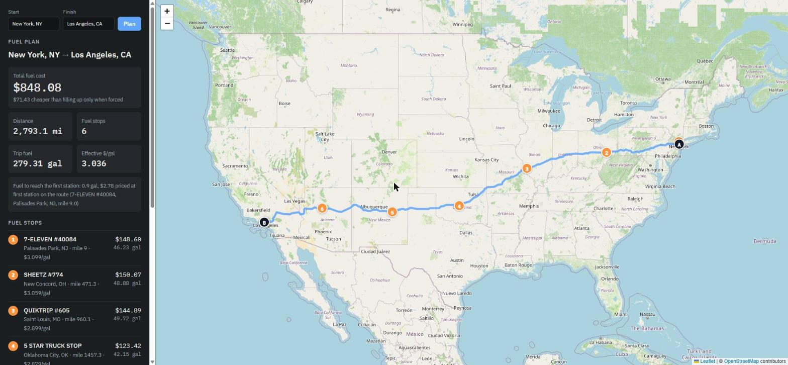

# Fuel Route Planner

[](https://github.com/Mr-Percival/spotter-fuel-route/actions/workflows/ci.yml)  

A Django REST API that takes a start and a finish location in the USA and returns:

- the driving route (GeoJSON) and a link to an interactive map,
- the **cost-optimal** fuel stops along it (500-mile range, 10 mpg, prices from the provided truck-stop list),
- the total money spent on fuel for the trip.

It makes **one call** to the routing API per trip (OpenRouteService). Repeated trips are served from cache.

**Live demo** (Vercel): [map, New York → Los Angeles](https://spotter-fuel-route-psi.vercel.app/map/?start=New%20York,%20NY&finish=Los%20Angeles,%20CA) · API at `https://spotter-fuel-route-psi.vercel.app/api/route/`. The first request after a quiet period takes a few seconds while the instance loads the stations.

```
POST /api/route/   {"start": "New York, NY", "finish": "Los Angeles, CA"}

→ 2,793 mi · 279.3 gal of fuel · 6 stops · $848.08
  ($71.43 cheaper than refuelling only when forced)
  routing ≈2.2 s (OpenRouteService) + ≈75 ms of our own work · cache hit ≈10 ms
```



## Quick start

Requires Python 3.12+ and a free [OpenRouteService key](https://openrouteservice.org/dev/#/signup).

```bash
python -m venv .venv && source .venv/bin/activate     # Windows: .venv\Scripts\activate
pip install -r requirements.txt
cp .env.example .env                                  # then set ORS_API_KEY (DEBUG=True for local use)
python manage.py migrate
python manage.py load_stations                        # loads the committed, geocoded stations
python manage.py runserver
```

Then:

- **API:** `POST http://127.0.0.1:8000/api/route/`. The Postman collection is in `postman_collection.json`.
- **Map:** http://127.0.0.1:8000/map/?start=New%20York,%20NY&finish=Los%20Angeles,%20CA
- **Tests:** `pytest` runs 956 tests in a few seconds (≈3 s on CI) with the routing API mocked:
  - 20 API tests, 22 geocoding, 4 corridor, 4 data;
  - the optimiser checked against exact solutions on 800 random instances.

## API

`POST /api/route/` (GET with the same query parameters also works)

| field | type | |
|---|---|---|
| `start`, `finish` | string | `"City, ST"`, `"City, State"` or `"lat,lon"` (contiguous US) |
| `initial_fuel_gallons` | number, optional | Fuel already in the tank (0–50), not charged. **Omit it** to charge the whole trip. |
| `stop_cost_usd` | number, optional | Fixed cost of each fuel stop (driver time, idling). Default **25**; `0` gives the pure cheapest-fuel plan. |

<details><summary>Response (trimmed)</summary>

```json
{
  "origin": {"query": "New York, NY", "resolved": "New York, NY", "lat": 40.663097, "lon": -73.938716},
  "destination": {"query": "Los Angeles, CA", "resolved": "Los Angeles, CA", "lat": 34.019649, "lon": -118.410351},
  "distance_miles": 2793.1,
  "duration_hours": 53.6,
  "assumptions": {"tank_gallons": 50.0, "mpg": 10.0, "max_range_miles": 500.0,
                  "initial_fuel": "enough to reach the first station on the route, charged at its price",
                  "stop_cost_usd": 25.0, "corridor_miles": 10.0,
                  "detour": "round trip to an off-route station is paid in fuel at its price",
                  "price_rule": "lowest retail price per OPIS station id"},
  "summary": {"total_cost": 848.08, "trip_fuel_gallons": 279.31, "stops": 6,
              "gallons_bought_at_stops": 278.41,
              "origin_fuel": {"gallons": 0.9, "price_per_gallon": 3.099, "cost": 2.78,
                              "priced_at": "first station on the route (7-ELEVEN #40084, Palisades Park, NJ, mile 9.0)"},
              "effective_price_per_gallon": 3.036, "savings_vs_naive": 71.43},
  "fuel_stops": [
    {"sequence": 1, "opis_id": 62790, "name": "7-ELEVEN #40084", "address": "US-46/US-1/US-9",
     "city": "Palisades Park", "state": "NJ", "mile": 9.0, "off_route_miles": 8.6,
     "price_per_gallon": 3.099, "gallons": 46.23, "cost": 148.6,
     "lat": 40.850189, "lon": -73.986573, "geo_precision": "address"}
  ],
  "route": {"type": "Feature", "geometry": {"type": "LineString", "coordinates": [[-73.94, 40.66], "..."]}},
  "map_url": "/map/?start=New+York%2C+NY&finish=Los+Angeles%2C+CA",
  "meta": {"routing_api_calls": 1, "routing_profile": "driving-hgv", "stations_in_corridor": 403,
           "cache": "miss", "timings_ms": {"geocode": 0.1, "routing": 2216.9, "corridor": 31.3,
                                            "optimize": 44.4, "total": 2292.7}},
  "warnings": ["Some stops are located at their city's centroid because the dataset lists highway exits rather than street addresses."]
}
```
</details>

`total_cost` = fuel bought at the stops (including the detour to reach them) + `origin_fuel`.

**Errors** share one shape, `{"error": {"code", "message", ...}}`:

| status | code | example |
|---|---|---|
| 400 | `invalid_request` | missing field, malformed JSON, `initial_fuel_gallons` > 50 |
| 400 | `ambiguous_location` | `"Springfield"`: lists `Springfield, IL`, `Springfield, MO`, … |
| 400 | `invalid_location` | unknown city/state; `lat,lon` outside the US (e.g. Toronto, or swapped coordinates); start = finish |
| 422 | `unroutable_location` | `"Anchorage, AK"` (road access only through Canada), `"Honolulu, HI"` |
| 422 | `fuel_gap` | `San Francisco → Seattle`: *no station between mile 0 and 548* |
| 422 | `no_route` | the routing engine finds no road |
| 429 | `throttled` / `routing_rate_limited` | our rate limit (60/min per client) or the routing API's |
| 502 / 504 | `routing_*` | routing API error or timeout |
| 503 | `stations_not_loaded` | `load_stations` was not run (checked before spending a routing call) |

## How it works

```
start, finish ──► local geocoder (Census) ──► 1 × OpenRouteService directions (driving-hgv)
                                                         │ route polyline + distance
     6,464 stations (in memory, KD-tree) ──► corridor search ──► stations with mile markers
                                                         │
                     exact optimiser (stop + detour costs) ──► stops, gallons, cost
```

1. **Geocoding without API calls.** `"City, ST"` is resolved against the US Census Gazetteer (cities, towns, CDPs and townships).
   - Each place was pre-snapped once to the nearest truck-routable road (`scripts/snap_places.py`). Census "internal points" can sit off-road: San Francisco's is in the Pacific because the city includes the Farallon Islands.
   - A `lat,lon` input must lie within 25 mi of a US place. The bounding box of the lower 48 also contains Toronto and Monterrey.
2. **One routing call.** It goes to OpenRouteService with `avoid_borders: "all"`, so US→US trips stay in the US. Without it, Detroit → Buffalo would cut through Ontario.
3. **Corridor search.**
   - The route is densified to 1-mile steps.
   - A KD-tree over 3-D unit vectors finds, for every station in one vectorised query, its nearest route point within 10 miles. That point's cumulative distance becomes the station's mile marker.
   - This costs O(S log P) and takes 10–60 ms per trip, with no PostGIS needed.
4. **Optimal refuelling** (`routing/services/fuel_optimizer.py`, pure Python, no Django).
   - **Free stops: the classic greedy.** At each station:
     - if a cheaper station is within one tank, buy just enough to reach the first one;
     - otherwise, if the destination is in range, buy just enough to finish;
     - otherwise fill up and go to the cheapest station in range.

     This is optimal for linear prices; the proof is an exchange argument, in the docstring.
   - **Why that isn't enough for a truck.** With free stops, the optimum happily stops 18 times between Miami and Seattle to buy a single gallon here and there.
   - **The planner therefore minimises fuel + detour fuel + `stop_cost_usd` × stops exactly.**
     - It relies on a known structural result (Khuller, Malekian & Mestre, *To fill or not to fill*, 2007): with the set of stops fixed, every stop either fills the tank or buys just enough to reach the next stop.
     - So a DP over (stop, arrival state) is exact. Two observations make it fast:
       - filling up costs the same whatever the next stop is;
       - "just enough" reduces to a prefix-minimum query.
     - That gives O(n·k·log k), under 120 ms for coast-to-coast trips.
     - Result for Miami → Seattle: 8 stops instead of 18.
   - **Verified, not assumed** (`test_fuel_optimizer.py`):
     - greedy = exact integer DP on 400 random instances;
     - stop-cost DP = brute force on 300 instances with stop costs and detours;
     - stop-cost DP with zero stop cost = greedy on 100 more;
     - every plan is replayed to check the tank never overflows or runs dry.
5. **Caching and warm-up.** Results are cached per (origin, destination, options). The station and place indexes are built at server start (`config/wsgi.py`), not per request.

## Data pipeline (offline, results committed)

The provided CSV has no coordinates, and most addresses are highway exits ("I-44, EXIT 283 & US-69").

`python manage.py geocode_stations [--census]` does the following:

| step | result |
|---|---|
| keep the 50 states + DC (drops Canadian provinces) | 8,151 → 7,531 rows |
| one row per OPIS id, keeping the **lowest** price (905 rows repeated an id with different prices) | 6,626 stations |
| Census Bureau batch geocoder on the street address, accepted only within 25 mi of the city | 477 (7.4%) |
| otherwise the Census Gazetteer centroid of the city/town | 5,987 (92.6%) |
| unresolved (unincorporated places in neither source) | 162 dropped (2.4%) |
| fix mojibake (`Stuckey’s` → `Stuckey’s`) | ✓ |

Total: **6,464 stations (97.6%)** loaded into the `Station` model.

## Assumptions and trade-offs

- **The trip pays for all of its fuel.** The truck leaves with just enough fuel to reach the first station on the route, and that fuel is charged at that station's price. Usually it is a few miles away, but from San Francisco the first station is in Reno, and the response warns about it. Pass `initial_fuel_gallons` to say the tank already holds (paid) fuel.
- **Each stop costs $25 by default** (`stop_cost_usd`, configurable), and the detour to an off-route station is paid in fuel. This avoids plans that stop for one gallon. `stop_cost_usd: 0` gives the pure cheapest-fuel plan.
- **Stations within 10 miles of the route count as on-route.** Most stations sit at their city's centroid, so a tighter corridor would miss real highway stops. The width is configurable with `CORRIDOR_MILES`.
- **Duplicate ids use the lowest price**, as a dispatcher would pick the cheapest quote.
- **Dataset gaps are reported, not invented.** California has only 8 stations in the dataset, all in the south-east desert (Imperial and Coachella valleys). So San Francisco → Seattle has no station for its first 548 miles, more than the 500-mile range, and the API says so.
- **Not built, on purpose:** auth, PostGIS, async workers, a shared cache.
  - The spatial work runs in memory in milliseconds for about 6.5k stations.
  - At scale this would move to PostGIS (`ST_DWithin` on the route line) and Redis.
  - Responses carry the full route geometry (≈0.5 MB coast-to-coast). The cache is capped at 200 entries per process.

## Project layout

```
config/                     settings (env-driven), urls, wsgi warm-up
routing/
  models.py                 Station
  views.py, serializers.py  DRF endpoint, error handler, map page
  services/
    planner.py              orchestration, caching, response shape
    ors_client.py           the single routing call + error mapping
    geocode.py, places.py   local geocoding (Census Gazetteer)
    corridor.py, stations.py KD-tree corridor search
    fuel_optimizer.py       greedy + exact stop-cost optimiser (pure Python)
  management/commands/      geocode_stations, load_stations
  tests/                    optimiser vs exact solutions, API (routing mocked), geocoding, corridor, data
scripts/                    one-off data preparation (Gazetteer build, road snapping)
data/                       assessment CSV + derived, committed data
```

Code: MIT licence (see `LICENSE`). Data sources: the assessment's fuel price CSV and the US Census Bureau (Gazetteer 2025, Geocoder; public domain). Routing and road snapping by © openrouteservice.org / OpenStreetMap contributors.
